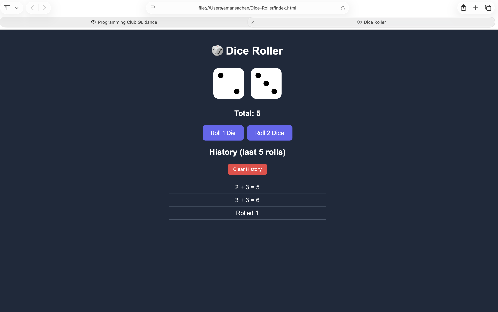

🎲 DiceLab — Dice Roller Website

A simple and interactive dice roller website built using HTML, CSS, and JavaScript. Roll one or two dice, view the total, and check your recent roll history.

✨ Features

* Roll two standard six-sided dice.
* Animated dice rolling effect.
* Automatically calculate the total of both dice.
* Display the history of the last 10 rolls.
* Save roll history in the browser using local storage.
* Responsive design for desktop and mobile devices.
* Accessible labels for the dice.

🛠️ Tech Stack

* HTML5 — website structure
* CSS3 — styling, responsive layout, and animations
* JavaScript — dice logic, event handling, and roll history
* Browser Local Storage — save roll history between visits

🚀 How to Run

* Download or clone this repository.

* Open the project folder in VS Code.

* Open index.html in your browser.

* No additional packages or installation are required.

🎲 How Randomness Works

JavaScript generates random values for the dice. The final dice values are selected from 1 to 6. The project uses crypto.getRandomValues() with rejection sampling to avoid modulo bias when choosing the final result.

The animation may show temporary values before the final dice results appear.

📁 Project Structure

Dice-Roller/
├── index.html

├── style.css

├── script.js

└── README.md

## 📸 Screenshots

👨‍💻 Author

Created as a beginner web development project to practise HTML, CSS, and JavaScript.
